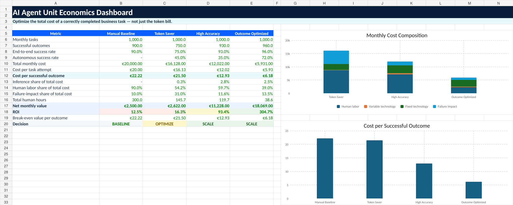
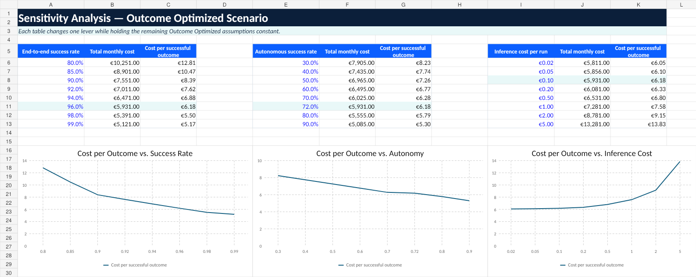

# AI Agent Unit Economics Calculator

A practical Excel model for evaluating AI agents by **cost per successful outcome**, rather than by token consumption alone.

The calculator accompanies the Medium article **“Your AI Agent Is Not Expensive Because of Tokens.”**



## Why this exists

Token usage is an important engineering metric, but it captures only one part of an agent's operating cost. A production agent can have a tiny model bill and still be expensive because of:

- human review and approval;
- rework and retries;
- manual fallback;
- platform and maintenance costs;
- failures with operational consequences.

The model uses the following core metric:

```text
Cost per successful outcome
=
Technology cost
+ Human supervision
+ Rework and fallback
+ Failure impact
───────────────────────────
Correctly completed tasks
```
You can read the article here https://medium.com/@antoniosql/the-real-cost-of-ai-agents-why-tokens-are-the-wrong-metric-bde02e0163c4 

## What is included

- `calculator/AI_Agent_Unit_Economics_Calculator.xlsx` — editable financial and operating model.
- `assets/dashboard-preview.png` — dashboard preview.
- `assets/sensitivity-preview.png` — sensitivity analysis preview.
- `data/example-scenarios.csv` — the illustrative assumptions used in the workbook.
- `docs/methodology.md` — definitions, formulas, and modeling guidance.


## Workbook structure

### Scenario Inputs

Editable assumptions are shown in blue font. The workbook includes:

- a manual operating baseline;
- a low-token-cost scenario;
- a high-accuracy but heavily reviewed scenario;
- an outcome-optimized scenario.

### Calculations

The model calculates:

- successful, autonomous, assisted, and failed tasks;
- human hours for assistance, quality review, rework, and fallback;
- variable and fixed technology costs;
- business impact of failure;
- total monthly cost;
- cost per attempted task;
- cost per successful outcome;
- value created, net value, and ROI.

### Dashboard

The dashboard compares all four operating models and includes:

- cost per successful outcome;
- success and autonomy rates;
- human effort;
- cost composition;
- inference, labor, and failure shares;
- net value and ROI;
- a simple `SCALE`, `OPTIMIZE`, or `RETIRE` signal.

### Sensitivity

The sensitivity sheet shows how unit economics change when you vary:

- end-to-end task success;
- autonomous success;
- inference cost per run.

The default scenario makes the central point visible: modest improvements in success and autonomy can matter far more than small reductions in token cost.



## Quick start

1. Download or clone the repository.
2. Open `calculator/AI_Agent_Unit_Economics_Calculator.xlsx`.
3. Replace the blue-font cells in `Scenario Inputs` with measured data.
4. Define a successful outcome at business-task level.
5. Review the dashboard and sensitivity analysis.
6. Compare agent versions using the same workload and success criteria.

## Important modeling guidance

The default values are illustrative and are **not industry benchmarks**.

Measure human effort whenever possible instead of estimating it. Assign failure cost by task class, because a harmless formatting issue and an incorrect business action do not have the same consequence.

Avoid double-counting benefits. For example, do not add full labor savings to a value-per-outcome figure that already includes those labor savings.

