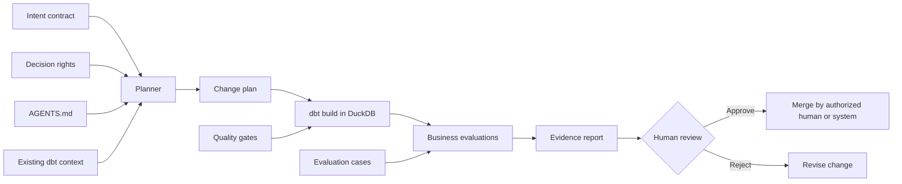

# Architecture

## Control plane and data plane

The reference implementation separates the **control plane** from the **data plane**.

- The **control plane** contains intent, rules, permissions, planning, validation policy, and evidence.
- The **data plane** contains seeds, transformations, tests, and the local DuckDB output.
- The agent may operate both planes only within its explicit decision rights.
- Merge and deployment remain outside the delegated boundary.

## Responsibility matrix

| Activity | Agent | Human reviewer | CI / platform |
|---|---:|---:|---:|
| Read approved context | Execute | Curate | Expose safely |
| Propose plan | Execute | Review when material | Persist evidence |
| Edit branch files | Execute | Inspect | Isolate branch |
| Run build and tests | Execute | Interpret exceptions | Enforce commands |
| Change metric definition | Prohibited | Decide | Record decision |
| Accept failed gate | Prohibited | Decide only through policy | Block by default |
| Merge | Prohibited | Approve / execute | Enforce protection |
| Deploy | Prohibited | Authorize | Execute with controlled identity |

## Why the planner is replaceable

The deterministic and OpenAI planners emit the same `RunPlan` schema. This makes model choice an implementation detail rather than a source of policy. An organization can swap the planner while preserving:

- contract validation;
- decision rights;
- dbt commands;
- evaluation cases;
- evidence format;
- human approval boundaries.

## Production extensions

A production design should add:

- ephemeral isolated workspaces;
- repository-scoped tool permissions;
- identity-aware data access;
- secret brokers and short-lived tokens;
- prompt and context versioning;
- signed commits and artifacts;
- policy-as-code for protected actions;
- trace, cost, and evaluation telemetry;
- incident response and rollback procedures;
- model/provider abstraction and failover.
